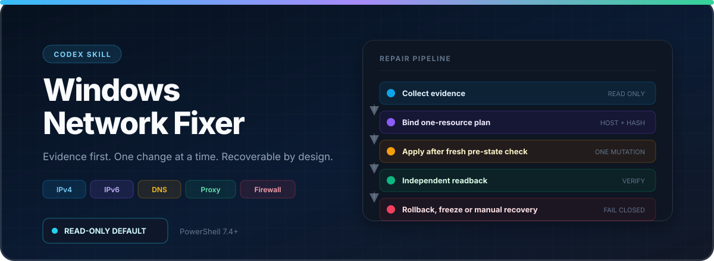
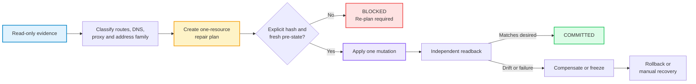

<a id="top"></a>

<div align="center">
  <h1>Windows Network Fixer</h1>
</div>

<div align="center">

[](https://github.com/MrLLLiao/windows-network-fixer)&#160;
[](LICENSE)&#160;
[](CHANGELOG.md)&#160;
[](https://www.microsoft.com/windows/)&#160;
[](https://learn.microsoft.com/powershell/)&#160;
[](https://github.com/MrLLLiao/windows-network-fixer)

**Evidence-first Windows network diagnosis, dual-stack validation, and bounded repair with rollback.**

[Overview](#overview) | [How It Works](#how-it-works) | [Features](#features) | [Quick Start](#quick-start) | [Safety Model](#safety-model) | [Validation](#validation) | [Citation](#citation)

</div>

<p align="center">
  
</p>

---

Windows Network Fixer is a Codex-compatible Windows skill that diagnoses local routing, DNS, IPv4/IPv6, proxy races, and firewall evidence, then applies one precisely scoped repair at a time.

Unlike blanket network resets, it keeps observation read-only until a host-, user-, and hash-bound plan is approved. Every mutation is checked against a fresh pre-state and an independent readback, with conditional rollback when verification fails.

## Table of Contents

- [Overview](#overview)
- [How It Works](#how-it-works)
- [Features](#features)
- [Project Structure](#project-structure)
- [Quick Start](#quick-start)
- [Safety Model](#safety-model)
- [Validation](#validation)
- [Community](#community)
- [Citation](#citation)
- [Star History](#star-history)

## Overview

### ✨ Highlights

<table>
<tr>
<td align="center" width="25%">🪟<br/><b>Windows-Native</b><br/><sub>PowerShell 7.4+, ActiveStore routes, CIM DNS and firewall profiles</sub></td>
<td align="center" width="25%">🌐<br/><b>Dual-Stack Truth</b><br/><sub>IPv4 and IPv6 tested independently; no inferred success</sub></td>
<td align="center" width="25%">🧭<br/><b>Path Evidence</b><br/><sub>Explicit destination IP, source bind, TCP and optional TLS</sub></td>
<td align="center" width="25%">🛰️<br/><b>Proxy Race Timeline</b><br/><sub>Sampled state plus native route, address, interface and registry events</sub></td>
</tr>
<tr>
<td align="center">🧩<br/><b>One-Resource Plans</b><br/><sub>Exact route, metric, DNS family, proxy or firewall target</sub></td>
<td align="center">🔐<br/><b>Hash-Bound Execution</b><br/><sub>Host, user, request, pre-state, target and executable identity</sub></td>
<td align="center">🧯<br/><b>Failure-Closed Recovery</b><br/><sub>Write-ahead events, readback, freeze and conditional rollback</sub></td>
<td align="center">🔎<br/><b>Security Evidence</b><br/><sub>Process image hash, signatures, firewall and bounded local events</sub></td>
</tr>
</table>

### 📢 News

- **2026-11-04** 🚀 **v1.1.0** — Restored the missing tracked state module and added a clean-checkout release gate.
- **2026-11-04** 🚀 **v1.0.1** — Renamed to `windows-network-fixer`, added the public repository and MIT license.
- **2026-11-04** 🧰 **v1.0.0** — Added bounded production repair, audit, watch, native event subscriptions, path probes and process checks.
- **2026-11-04** 🧪 **v0.2.0** — Added offline transaction semantics, same-host IPv4/IPv6 socket validation and an isolated Hyper-V lab.
- **2026-11-03** 🎉 **v0.1.0** — Initial read-only FlClash/Windows network investigation release.

## How It Works



| Stage | What happens | Evidence or guard |
|:---|:---|:---|
| **Observe** | Collect interfaces, routes, DNS, proxy processes, sockets and firewall state | Read-only default; missing collectors stay `BLOCKED` or `UNKNOWN` |
| **Classify** | Separate IPv4, IPv6, DNS, TUN/VPN and proxy hypotheses | A successful connection is not automatically proof of native egress |
| **Plan** | Bind one resource's current state and desired state to the host and user | Plan expires after 10 minutes; exact SHA-256 approval is required |
| **Apply** | Recheck the resource, mutate once and read it back | Global mutex, restricted ProgramData ACL and immutable write-ahead events |
| **Recover** | Compare observed state with the saved pre-state | Conditionally roll back; freeze later writes when ownership is uncertain |

## Features

| Capability | Command | Output or boundary |
|:---|:---|:---|
| Baseline diagnosis | `diagnose` | Interfaces, routes, DNS, known proxy processes and address-family status |
| Broad local audit | `audit` | TCP/UDP ownership, firewall policy, Defender state, bounded events and report |
| Configuration watch | `watch` | Sampled snapshots, normalized diffs and a change timeline |
| Native event watch | `watch-events` | Route, IP interface, unicast address and current-user proxy registry notifications |
| Explicit path test | `path-probe` | Numeric destination, optional source bind, TCP and TLS hostname validation |
| Process inspection | `process-check` | PID and start time, disk image SHA-256, signer and certificate status |
| Repair planning | `repair-plan` | One host-bound resource plan with pre-state, desired state and expiry |
| Execution | `apply` | Hash-gated mutation, readback, committed or compensated terminal state |
| Recovery | `repair-status`, `rollback` | Transaction inspection and conditional restoration of the saved pre-state |

Supported repair kinds:

- ActiveStore route metric, single route add and single route remove
- Interface metric
- Static or automatic DNS for one address family
- Current-user system proxy enable or disable
- Firewall profile enable and dropped-packet logging
- Exact program or single remote-IP firewall block

## Project Structure

```text
windows-network-fixer/
├── SKILL.md                      # Agent entry and operating contract
├── README.md
├── LICENSE
├── agents/
│   └── openai.yaml               # Codex UI metadata and invocation policy
├── manifests/
│   └── compatibility.json        # Versions, capabilities and tested scope
├── references/                   # Diagnostics, repair, recovery, security and lab guides
├── schemas/                      # Legacy observation and transaction contracts
├── scripts/
│   ├── entrypoints/              # Public command surface
│   ├── diagnostics/              # Read-only network collectors
│   ├── audit/                    # Security and event evidence
│   ├── repair/                   # Plan, mutation, readback and rollback coordinator
│   ├── validation/               # Socket, path and TLS probes
│   ├── transactions/             # Offline transaction state machine
│   ├── lab/                      # Isolated Hyper-V validation
│   └── install/                  # Byte-verified skill installer
└── tests/                        # Regression, live smoke and clean-release checks
```

## Quick Start

### 1. Clone And Install

```powershell
git clone https://github.com/MrLLLiao/windows-network-fixer.git
Set-Location .\windows-network-fixer

pwsh -NoProfile -File .\scripts\install\Install-NetworkSkill.ps1 -WhatIf
pwsh -NoProfile -File .\scripts\install\Install-NetworkSkill.ps1
```

The installer verifies every file by SHA-256 and backs up an existing installation under `%LOCALAPPDATA%\CodexSkillBackups`. It does not change network settings.

### 2. Run Read-Only Diagnosis

```powershell
$entry = Join-Path $HOME '.codex\skills\windows-network-fixer\scripts\entrypoints\Invoke-NetworkSkill.ps1'
$state = Join-Path $env:LOCALAPPDATA 'CodexNetworkState'

& $entry -Intent diagnose -StateRoot $state
& $entry -Intent audit -StateRoot $state
```

Ordinary diagnosis does not require elevation. Collectors that cannot run remain visible as `BLOCKED` or `UNKNOWN`; they are not converted into healthy results.

### 3. Capture An Intermittent Failure

```powershell
& $entry -Intent watch -StateRoot $state -Samples 10 -IntervalMilliseconds 500
& $entry -Intent watch-events -StateRoot $state -DurationSeconds 30

& $entry -Intent path-probe `
  -ProbeAddress '<destination-ip>' `
  -ProbePort 443 `
  -TlsName '<hostname>'
```

Use a destination IP from the reported failure. For IPv6 or multi-homed hosts, add `-SourceAddress '<local-ip>'`.

### 4. Plan And Apply A Repair

Create a request using [references/repair.md](references/repair.md), then inspect the generated plan before execution:

```powershell
$plan = & $entry -Intent repair-plan `
  -RepairRequestPath '<request.json>' `
  -StateRoot $state

$plan | Format-List
& $entry -Intent apply `
  -RepairPlanPath $plan.planPath `
  -ApprovedPlanHash $plan.planHash `
  -WhatIf
```

Apply, verify and roll back with the exact same plan and hash:

```powershell
& $entry -Intent apply -RepairPlanPath $plan.planPath -ApprovedPlanHash $plan.planHash
& $entry -Intent repair-status -RepairPlanPath $plan.planPath -ApprovedPlanHash $plan.planHash
& $entry -Intent rollback -RepairPlanPath $plan.planPath -ApprovedPlanHash $plan.planHash
```

Production transactions are stored in `%ProgramData%\CodexNetworkRepair`, independently of the observation `-StateRoot`.

## Safety Model

- **Read-only until explicit repair.** Diagnosis, audit, watch and probes do not modify network configuration.
- **One resource per plan.** A plan cannot silently fan out into route, DNS, proxy and firewall changes.
- **Fail closed on drift.** Host, user, pre-state, target or executable identity changes invalidate execution.
- **No blind replay.** An interrupted apply must be inspected before another mutation is attempted.
- **No destructive shortcuts.** The skill does not disable firewalls, wipe all routes, reset Winsock or stop every proxy as a generic fix.
- **No automatic malware response.** `process-check` inspects only the named process. It does not terminate processes, delete files or scan third-party hosts.
- **No false all-clear.** Missing logs, unsigned files, listening ports and normal connections do not independently prove compromise or safety.

Detailed operating guidance lives in [security.md](references/security.md), [recovery.md](references/recovery.md) and [contracts.md](references/contracts.md).

## Validation

```powershell
& .\tests\Invoke-Tests.ps1
& .\tests\Invoke-RepairTests.ps1
& .\tests\Invoke-LiveSmoke.ps1
& .\tests\Invoke-CleanReleaseTest.ps1
```

| Suite | Scope | Current result |
|:---|:---|:---|
| Legacy regression | Contracts, storage, routing logic, tracked release source and recovery semantics | **78 / 78** |
| Repair regression | Coordinator failure paths and leaf providers with mocked Windows APIs | **26 / 26** |
| Live smoke | IPv4/IPv6 loopback, untrusted TLS rejection, native subscriptions and isolated install | **5 / 5** |
| Clean release | Tracked-manifest export, installer preview, fixture, socket gate, lab gate and both regression suites | **PASS** |

Production `apply` and `rollback` were not live-tested on the development host. Native public egress, proxy egress and live firewall blocking are not claimed as verified. See [compatibility.json](manifests/compatibility.json) for the exact tested scope.

## Community

Contributions are welcome for new evidence collectors, dual-stack playbooks, provider tests, documentation and safer recovery semantics.

- 🐞 **Bug reports and feature requests:** [GitHub Issues](https://github.com/MrLLLiao/windows-network-fixer/issues)
- 🔧 **Pull requests:** keep changes focused, add regression coverage and do not lower the production safety gates
- 🔐 **Sensitive data:** remove hostnames, public IPs, credentials, proxy secrets and private paths from reports before posting

## Citation

```bib
@software{windows_network_fixer,
  author = {MrLLLiao},
  title = {{Windows Network Fixer}},
  year = {2026},
  version = {1.1.0},
  url = {https://github.com/MrLLLiao/windows-network-fixer}
}
```

## Star History

<a href="https://www.star-history.com/?repos=MrLLLiao%2Fwindows-network-fixer&type=date&legend=top-left">
 <picture>
   <source media="(prefers-color-scheme: dark)" srcset="https://api.star-history.com/image?repos=MrLLLiao/windows-network-fixer&type=date&theme=dark&legend=top-left" />
   <source media="(prefers-color-scheme: light)" srcset="https://api.star-history.com/image?repos=MrLLLiao/windows-network-fixer&type=date&legend=top-left" />
   
 </picture>
</a>

<p align="right"><a href="#top">🔝 Back to top</a></p>
